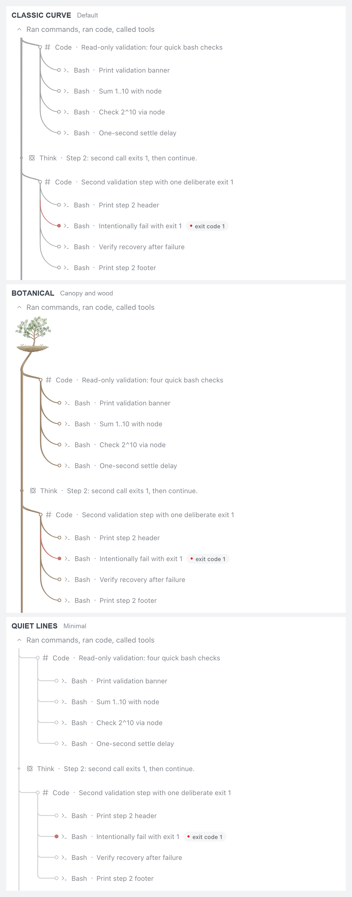
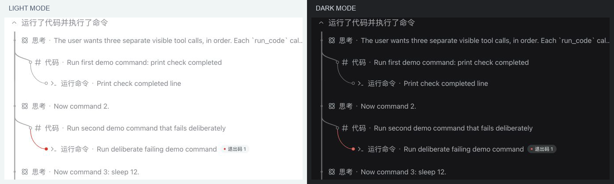
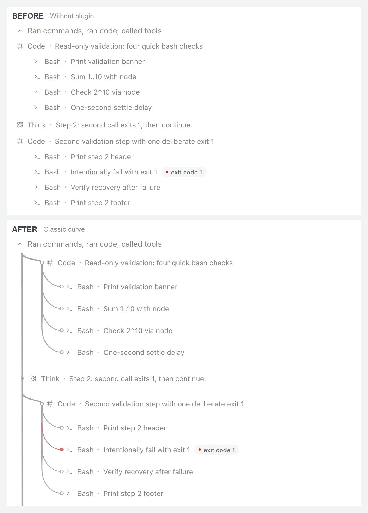
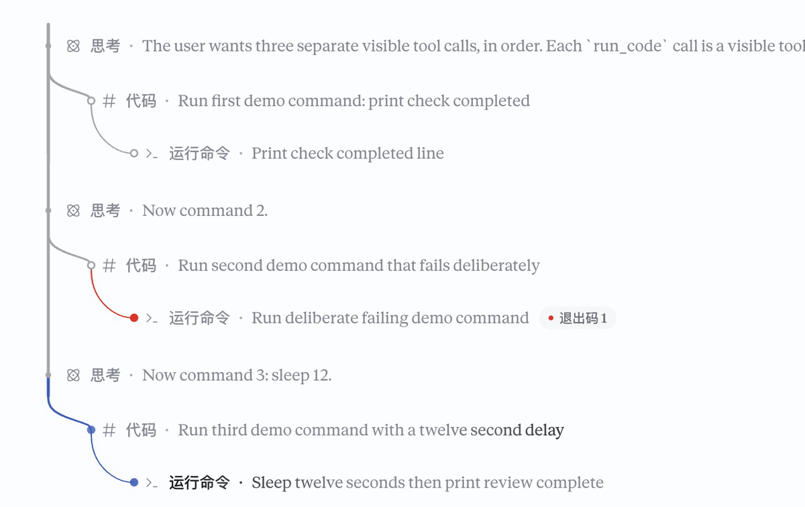
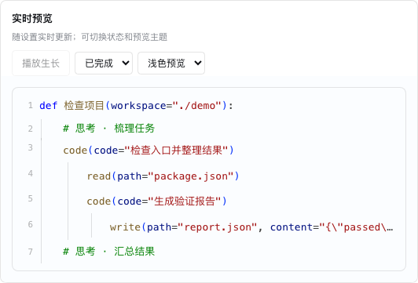
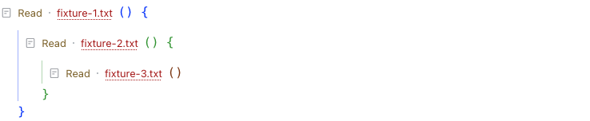

# dsh-process-tree

[中文](README.md)

A process view for DeepSeek Harness: code blocks by default, with optional classic branches, quiet lines and botanical artwork. Supports nested calls, status indicators, viewport rendering and reduced motion.

This community UI plugin targets DSH Web and the Desktop web interface. It does not render in TUI. See [compatibility and verification](docs/COMPATIBILITY.md) for tested environments and limits.

## See it in action

These examples come from a real DSH Desktop conversation with three read-only steps and several nested calls; one check fails deliberately.

### Three styles

The same branching excerpt shown from top to bottom in **classic curve**, **botanical**, and **quiet lines**.



### Light and dark

The same multi-branch process in the botanical style, shown in both interface themes:



### Before and after

The same records without the plugin above, and with Process Tree's classic curves below.



### States at a glance

Hollow dots mark completed tool steps, red marks the intentional failure, and blue shows a running call. In the botanical style, running branches retain their wood color.



The state image was captured from a dedicated Desktop demo. The style and comparison images replay sanitized records from that conversation in an isolated DSH Web instance and stitch scroll captures to show the nested branches. Images use the appearance settings selected at capture time; state colors are customizable.

## Install

Version 0.8.2 declares **DSH 0.2.1-rc.2 and 0.2.1-rc.5**. rc.5 passed isolated Web-host checks and a macOS Desktop spot check; Windows, Linux and other Desktop configurations remain unverified. The earlier npm 0.8.0 release declares rc.2 only; check the compatibility of the selected version or use the pinned GitHub installation below. See [compatibility](docs/COMPATIBILITY.md).

### Install through Discover

1. Open **Plugins → Experimental plugins** and enable **Custom plugin markets** (called **Custom plugin indexes** in some builds).
2. Open **Discover → Add index source**, or use **Manage index sources…** in the market menu when a source already exists.
3. Add the full URL below and select **Process Tree by Bosaiting**.

```text
https://raw.githubusercontent.com/Bosaiting/dsh-process-tree/main/market/index.json
```

Search for `dsh-process-tree` or **Process Tree**. Check the **`dsh-process-tree`** version, its DSH compatibility and the **`https://registry.npmjs.org`** source, confirm, and restart when prompted. An installed card opens the existing plugin. Sources belong to the current profile and must be added by each user.

This is an independent community index maintained by the project owner. See the [Discover guide](docs/DISCOVER.md) for troubleshooting and maintenance.

### Command-line or offline installation

Check the declared DSH compatibility before installing the latest version from [npm](https://www.npmjs.com/package/dsh-process-tree):

```sh
npm view dsh-process-tree version engines
dsh plugin --profile web add dsh-process-tree@latest
```

Install the rc.5-compatible pinned version from GitHub:

```sh
dsh plugin --profile web add "github:Bosaiting/dsh-process-tree#v0.8.2"
```

Alternatively, download the npm package and install it locally:

```sh
npm pack dsh-process-tree@latest
# Replace the filename with the one printed by npm pack
dsh plugin --profile web add ./dsh-process-tree-VERSION.tgz
```

Restart the corresponding DSH instance. Use Desktop's plugin manager for its managed configuration. The Desktop-bundled CLI also handled its `desktop` profile in the verified macOS build; a separately installed CLI may differ. No install-time build is required. Claude Style is optional. Disable overlapping indentation or process-connector plugins, including `dsh-tool-indent`, to avoid competing spacing and CSS variables.

## Code blocks: task functions (0.10.0)

The fourth style now defaults to Python-like task functions: an outer `def task_01(workspace="..."):` with genuine tool names and arguments inside, green reasoning comments, a narrow line-number gutter and indentation guides. A suitable short recorded title becomes the function name; otherwise a stable numbered name is used. This is a visualization of recorded execution, not executable Python.

The current source also offers JavaScript, C and C++ under **Code layout → Task function → Display language**. JavaScript shows recorded named arguments as an object. C and C++ label argument names in comments, mark arrays and objects as JSON, and label null without inferring a pointer or a parameter type; unusual tool names are shown in a comment. C++ uses its own keyword rules and a `.cpp` virtual tab. These styles use `//` reasoning comments and braces for nesting. Scope braces group recorded children without inventing callbacks or types. All language views are read-only visualizations, not original source or executable programs; display order does not establish that children ran sequentially. Existing language preferences remain unchanged, and missing language settings retain Python. The separate trailing-braces layout is unchanged. Check the installed release separately for availability.

The Java view shows simple values in their recorded order, such as `read("src/Main.java", 20)`. The disclosure opens the recorded arguments including names. Objects, arrays, incomplete records and tool names unsuitable as Java method names retain the native summary and provide access to recorded raw arguments. Display order does not establish an actual Java signature. The `.java` tab is virtual and no source file is created.

The Go view uses a `.go` virtual tab, a `func` heading, and recorded positional values; the disclosure retains raw named arguments and `null` is shown as `nil`. Composite or incomplete arguments and names unsuitable as Go identifiers retain native summaries. Separate blocks group recorded children without asserting a function signature or execution order. The view is read-only and does not create executable source.



The view borrows the UI's already-loaded current Chat projection and matches native row identities. Short calls remain inline; longer calls wrap, and ellipsis buttons disclose long or additional values. File arguments delegate to the retained native file action, and native result disclosure remains available. Missing records, incomplete arguments and special interactive summaries fall back conservatively instead of guessing parameters. Syntax colours remain independent of execution status. Data subscriptions are released when the view is inactive.

Within the task-function view, expanded native tool code uses the same font size as the call summary. Native syntax highlighting, copy and wrapping remain available.

Long histories convert progressively, prioritizing calls near the viewport; unconverted rows retain their native summaries. The minimap fills in as conversion progresses, while counts use the loaded structured records.

When the host marks a call as failed but its structured tool result records success, the count is shown separately as a host-marked failure; no exit code is inferred. Python, JavaScript, C and C++ views use an ellipsis when numbers or duplicate keys cannot be represented without changing the record. The argument disclosure preserves the raw recorded text, and an ambiguous native file action retains its native summary. Very long disclosures still refer to the original call details.

Choose **Trailing braces** under Code layout to retain `() {`, normal-flow closing rows, subtle scope guides and pair matching. Existing styles and visual preferences remain intact; the new `codeLayout` field defaults to `function`.



Colours follow VS Code Dark+/Light+: [official themes](https://github.com/microsoft/vscode/tree/main/extensions/theme-defaults/themes) and [bracket colour registry](https://github.com/microsoft/vscode/blob/main/src/vs/editor/common/core/editorColorRegistry.ts). The function preview uses synthetic examples; the brace screenshot uses an isolated rc.5 host with explicitly injected nesting. Neither executes models or tools for the capture.

## Settings

Open **Settings → Plugins → 过程树**. Code blocks are the default. Classic uses flowing tapered curves and leaves on finished tool steps. Quiet is the understated mode and uses 1.5 px uniform lines, rounded corners and dots of one size at every level; botanical adds a small original canopy, shaded wood roots and halos. The main settings cover style, intensity and animation. The three tree styles also allow separate six-digit HEX running and error colors for light and dark themes; changes apply immediately and are saved automatically. State colors can be reset without changing other preferences. Code style hides these controls while retaining saved colors.

Code blocks default to the task-function layout and Python, with VS Code Light+ for light mode, JetBrains Darcula for dark mode, and the preset background in the process view. Choose separate light and dark **Code colours** presets inspired by VS Code, JetBrains, Catppuccin and Dracula, or switch the background to follow DSH. The live preview can show either mode. Colours are adapted to this plugin's token roles, with some contrast adjustments, rather than a full IDE reproduction. Existing saved choices are preserved.

Expand the light or dark colour settings to adjust functions and tools, keywords, parameter names, strings and files, numbers, reasoning and comments, plain text, and three bracket levels. Each preset retains its own customisations; reset affects only the active preset and mode, while the full settings reset clears all presets. Existing colours migrate as custom VS Code values. Switching and editing colours work offline.

If an older version saves the settings after a downgrade, the active colours remain, but preset selections and customisations for other presets may be lost. Back up settings before downgrading if those preferences matter.

Classic's subtle, standard, and vivid presets use line widths of 3.10, 3.80, and 4.64 px respectively; botanical uses 3.20, 4.60, and 6.28 px. Saved line widths remain unchanged; choose an intensity again to apply its new preset.

Tree-style details (transitions, line width, texture, leaves, dots, indentation, summary dimming, leading, growth speed) live under a collapsed **Advanced** section. Changing line width or dots there marks intensity as custom; picking a level restores it. Botanical controls appear in that style. Code style hides the intensity and advanced controls. The settings preview shares the chat renderer and can switch both state and light/dark appearance. Quiet uses state colors on dots; botanical retains its wood-colored running branches while the node and glow use the running color. Reduced motion stops growth and state motion. Far-away history releases drawing resources while preserving layout space. Fresh installations and older preferences without a valid style use code blocks while retaining row appearance and canopy preferences. Explicit saved style choices remain unchanged.

Botanical Advanced settings include an opt-in **植物滚动优化** (botanical scrolling optimization), off by default. It can reduce browser style recalculation while scrolling long processes. When enabled, other plugins or custom CSS that directly query or alter the internal root graphics may no longer work; turn it off to restore the previous access. The settings preview is unaffected.

## Data and permissions

The function layout reads the current UI’s already-loaded Chat projection without loading more history. Calls with recorded children appear as nested scopes; leaf calls remain ordinary calls. These scopes visualize execution relationships and are not actual function definitions or executable code. A minimap navigates loaded, visible calls; dense marks are binned by position, prioritizing failures and running calls. Short calls remain on one line; longer calls or narrow rows expand to one argument per line. The heading counts loaded calls, recorded failures, and, when present, interrupted and unfinished calls, including nested calls. Completed calls show elapsed time only when both recorded timestamps are available. A read-only virtual tab labels each task; independent scope controls fold child calls without changing native result disclosure. Hover or keyboard focus highlights rows and indent guides, and recorded error messages or types are shown when available; otherwise the first result line is labelled as a result excerpt, not a cause. A failure list navigates loaded calls and unfolds plugin-owned scopes when possible; unavailable calls are marked. Collapsed scopes count recorded failed descendants, excluding interruptions. Failed, interrupted, and unknown outcomes are displayed and counted separately; in-flight calls remain unfinished. Unknown requires an explicit host indication or a result without a valid success/error flag. The verified host does not provide a dedicated unknown state. The plugin reads rendered chat structure and element sizes, and adds owned SVG, code expressions or CSS decorations. It registers no model tools, executes no commands and sends no network requests. Preferences stay in the current interface's `localStorage` under `dsh.process-tree.v1`. It does not change session content or read API keys. Uninstalling retains preferences; use the settings reset control to restore defaults.

If local storage cannot be read or written, settings show a warning. After storage recovers, another change retries the save.

## Remove

```sh
dsh plugin --profile web remove dsh-process-tree
```

Restart the corresponding instance; use the plugin manager on Desktop. Keep the rest of the profile.

## Develop

Node.js 22.19 or newer. Runtime JavaScript is checked in and needs no build. React and Playwright development dependencies serve tests only.

```sh
npm ci
npm test
npx playwright install chromium
npm run test:browser
npm run check:package
npm pack
```

Set `DSH_CHROMIUM_EXECUTABLE` to use an existing Chromium. Settings-preview tests use the pinned React dependencies by default. Optional coexistence checks accept `DSH_COMPOSER_SOURCE` and `DSH_CLAUDE_ROW_SKIP_CSS`; ordinary tests need no other plugin checkout.

The older static style illustrations can be regenerated with `node scripts/capture-previews.mjs` after installing Chromium. The command also accepts `DSH_CHROMIUM_EXECUTABLE`. The live recording and replay screenshots above must be captured through DSH.

`canopy.svg` preserves the original artwork. Runtime uses the parameterized artwork embedded in `client.js`; editing the original does not automatically update that embedded form. The original is not duplicated in the install archive.

See [compatibility](docs/COMPATIBILITY.md) for real-host checks. Host-shaped DOM tests do not establish native Desktop frame rates. Bug reports should include DSH version, OS, selected style, UI plugins and reproduction steps, without private conversation data.

## License

MIT; see [LICENSE](LICENSE). The canopy is original artwork by the project owner. Row indentation, summary dimming and leading adapt Asheep233's [dsh-tool-indent](https://github.com/Asheep233/dsh-tool-indent). Its original notice is retained in [THIRD_PARTY_NOTICES.md](THIRD_PARTY_NOTICES.md).
