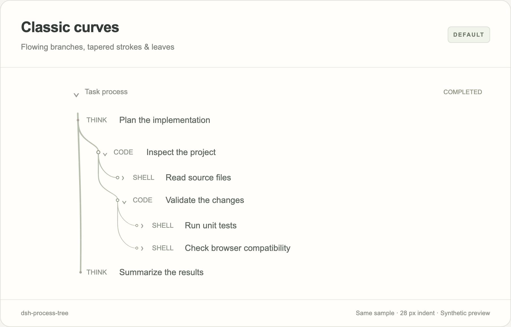
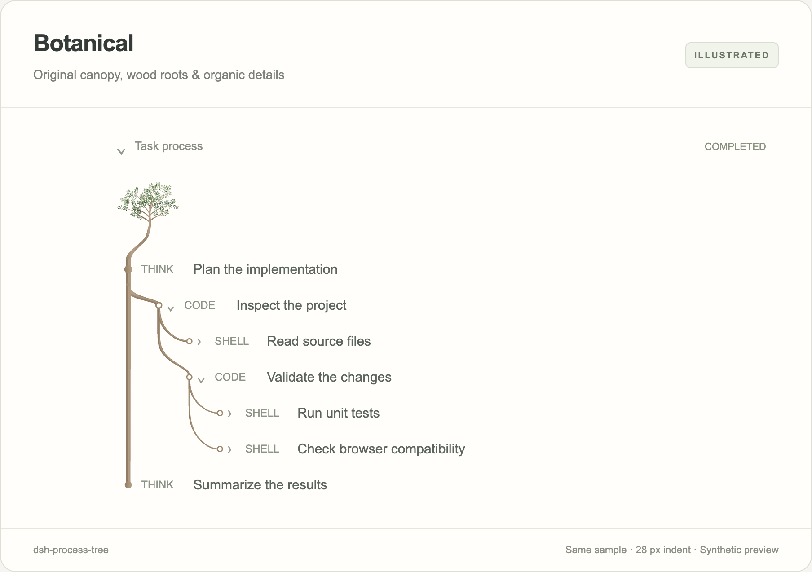
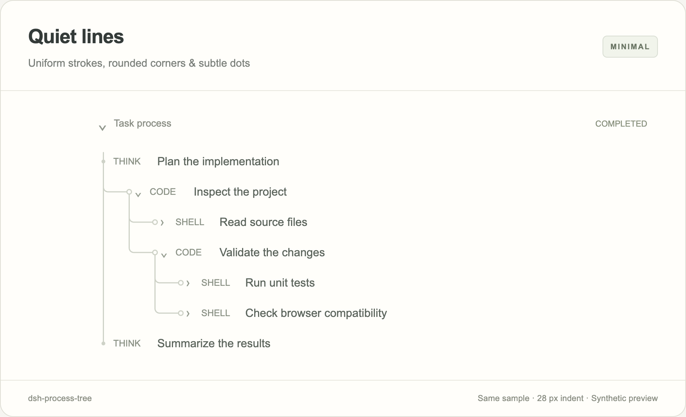

# dsh-process-tree

[中文](README.md)

A process tree for DeepSeek Harness: classic flowing branches by default, with optional quiet lines and botanical artwork. Supports nested calls, state dots, viewport rendering and reduced motion.

This community UI plugin targets DSH Web and the Desktop web interface. It does not render in TUI. See [compatibility and verification](docs/COMPATIBILITY.md) for tested environments and limits.

## Style previews

These images use the actual plugin renderer, the same synthetic transcript and a 28 px indent for comparison. They contain no private conversation data.

### Classic curves (default)

Flowing branches with a clear taper, drawn in the interface's own text colour. A leaf sprouts when a tool step finishes; running and failed steps stay bare.



### Botanical

A small original canopy emblem tops shaded wood roots (5.6 px line-width preset) that connect the calls into a tree. The crown is about 70 px tall and stays inside the content area.



### Quiet lines (understated)

For when you want no decoration: uniform thin strokes, rounded corners and one dot size, close to an editor's indent guides.



## Install

The currently verified host is **DSH 0.2.1-rc.2**. Other versions are unverified.

### Install through Discover

1. Open **Plugins → Experimental plugins** and enable **Custom plugin markets** (called **Custom plugin indexes** in some builds).
2. Open **Discover → Add index source**, or use **Manage index sources…** in the market menu when a source already exists.
3. Add the full URL below and select **Process Tree by Bosaiting**.

```text
https://raw.githubusercontent.com/Bosaiting/dsh-process-tree/main/market/index.json
```

Search for `dsh-process-tree` or **Process Tree**. Check that the installation targets **`dsh-process-tree@0.7.4`** from **`https://registry.npmjs.org`**, confirm, and restart when prompted. An installed card opens the existing plugin. Sources belong to the current profile and must be added by each user.

This is an independent community index maintained by the project owner. See the [Discover guide](docs/DISCOVER.md) for troubleshooting and maintenance.

### Command-line or offline installation

Install the pinned version from [npm](https://www.npmjs.com/package/dsh-process-tree):

```sh
dsh plugin --profile web add dsh-process-tree@0.7.4
```

Alternatively, install the pinned version from GitHub:

```sh
dsh plugin --profile web add "github:Bosaiting/dsh-process-tree#v0.7.4"
```

Alternatively, download `dsh-process-tree-0.7.4.tgz` from the [v0.7.4 Release](https://github.com/Bosaiting/dsh-process-tree/releases/tag/v0.7.4) and install it locally:

```sh
dsh plugin --profile web add ./dsh-process-tree-0.7.4.tgz
```

Restart the corresponding DSH instance. Use Desktop's plugin manager for its managed configuration. The Desktop-bundled CLI also handled its `desktop` profile in the verified macOS build; a separately installed CLI may differ. No install-time build is required. Claude Style is optional. Disable overlapping indentation or process-connector plugins, including `dsh-tool-indent`, to avoid competing spacing and CSS variables.

## Settings

Open **Settings → Plugins → 过程树**. Classic is the default: flowing tapered curves, texture, and leaves on finished tool steps. Quiet is the understated mode and uses 1.5 px uniform lines, rounded corners and dots of one size at every level; botanical adds original canopy artwork, wood roots and halos. Selecting a style applies its preset; sliders remain editable.

Controls cover transitions, line width, indentation, summary dimming, leading, dots, growth and decoration. Botanical controls appear in that style. The settings preview shares the chat renderer. Reduced motion stops growth and state motion. Far-away history releases drawing resources while preserving layout space. Fresh installations and older preferences without a valid style use classic while retaining row appearance and canopy preferences. Explicit saved style choices remain unchanged.

## Data and permissions

The plugin reads rendered chat structure and element sizes, and adds decorative SVG. It registers no model tools, executes no commands and sends no network requests. Preferences stay in the current interface's `localStorage` under `dsh.process-tree.v1`. It does not change session content or read API keys. Uninstalling retains preferences; use the settings reset control to restore defaults.

## Remove

```sh
dsh plugin --profile web remove dsh-process-tree
```

Restart the corresponding instance; use the plugin manager on Desktop. Keep the rest of the profile.

## Develop

Node.js 22.19 or newer. Runtime JavaScript is checked in and needs no build. React and Playwright development dependencies serve tests only.

```sh
npm ci
npm test
npx playwright install chromium
npm run test:browser
npm run check:package
npm pack
```

Set `DSH_CHROMIUM_EXECUTABLE` to use an existing Chromium. Settings-preview tests use the pinned React dependencies by default. Optional coexistence checks accept `DSH_COMPOSER_SOURCE` and `DSH_CLAUDE_ROW_SKIP_CSS`; ordinary tests need no other plugin checkout.

Regenerate the README images with `node scripts/capture-previews.mjs` after installing Chromium. The command also accepts `DSH_CHROMIUM_EXECUTABLE`.

`canopy.svg` preserves the original artwork. Runtime uses the parameterized artwork embedded in `client.js`; editing the original does not automatically update that embedded form. The original is not duplicated in the install archive.

See [compatibility](docs/COMPATIBILITY.md) for real-host checks. Host-shaped DOM tests do not establish native Desktop frame rates. Bug reports should include DSH version, OS, selected style, UI plugins and reproduction steps, without private conversation data.

## License

MIT; see [LICENSE](LICENSE). The canopy is original artwork by the project owner. Row indentation, summary dimming and leading adapt Asheep233's [dsh-tool-indent](https://github.com/Asheep233/dsh-tool-indent). Its original notice is retained in [THIRD_PARTY_NOTICES.md](THIRD_PARTY_NOTICES.md).
