<div align="center">
  <h1>DSH Process Tree</h1>
  <p><strong>让 DeepSeek Harness 的工具调用过程更清晰、更易导航。</strong></p>
  <p>任务函数 · 代码配色 · 可交互过程树</p>
  <p>
    <a href="README.md"></a>
    <a href="README.en.md"></a>
  </p>
  <p>
    <a href="https://www.npmjs.com/package/dsh-process-tree"></a>
    <a href="https://www.npmjs.com/package/dsh-process-tree"></a>
    <a href="https://github.com/Bosaiting/dsh-process-tree"></a>
    <a href="LICENSE"></a>
  </p>
</div>

默认代码模式以任务函数、参数、注释和嵌套作用域呈现已记录的调用；也可以切换为经典曲线、安静线条或植物手稿。

这是社区界面插件，适用于 DSH Web 和使用同一界面的桌面版；TUI 不显示插件界面。

## 快速安装

```sh
dsh plugin --profile web add dsh-process-tree@latest
```

安装后重启对应 DSH 实例。桌面版可使用插件管理界面；其他安装方式见[安装说明](#安装)。

## 效果预览

### 默认代码模式

任务函数显示已加载的调用、真实参数、失败状态和嵌套关系。右侧迷你地图可以定位已显示的调用；文件和网页地址保留宿主原有操作。

| 深色模式 | 浅色模式 |
|:---:|:---:|
| [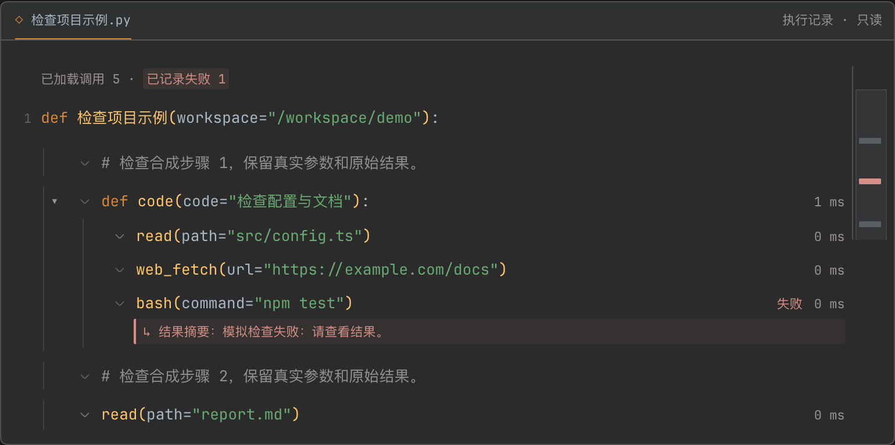](docs/images/code-view-dark.png) | [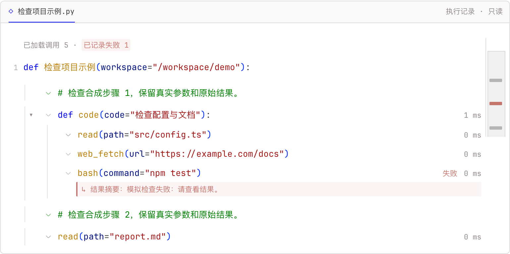](docs/images/code-view-light.png) |

点击“已记录失败”可以查看列表，选择条目后跳转到对应调用，并在需要时展开插件折叠的父作用域：

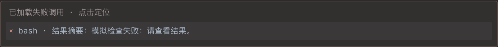

上方截图来自隔离 DSH 宿主中的**合成会话**：文件、网址、输出和失败均为演示数据，没有运行模型或工具，也没有访问示例网址。截图以 2 倍像素密度采集；点击图片可查看原尺寸。

### 代码配色

浅色与深色方案可以分别选择，背景可跟随界面或使用配色方案背景。以下为实际设置预览中的四种深色方案：

| VS Code Dark+ | JetBrains Darcula |
|:---:|:---:|
| 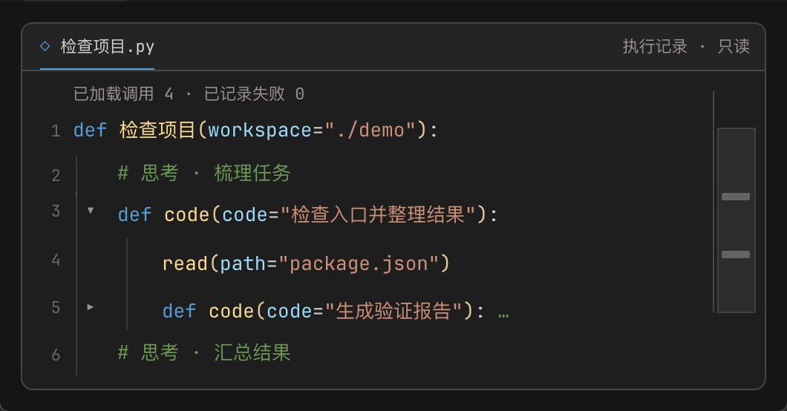 | 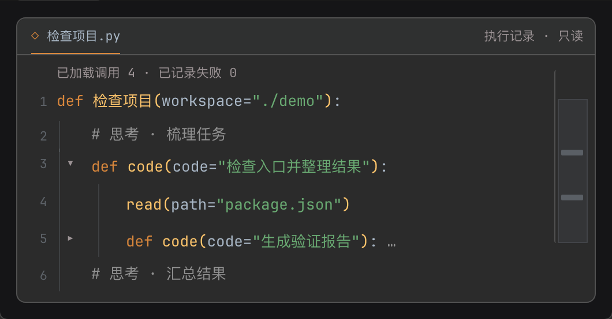 |
| **Catppuccin Mocha** | **Dracula Classic** |
| 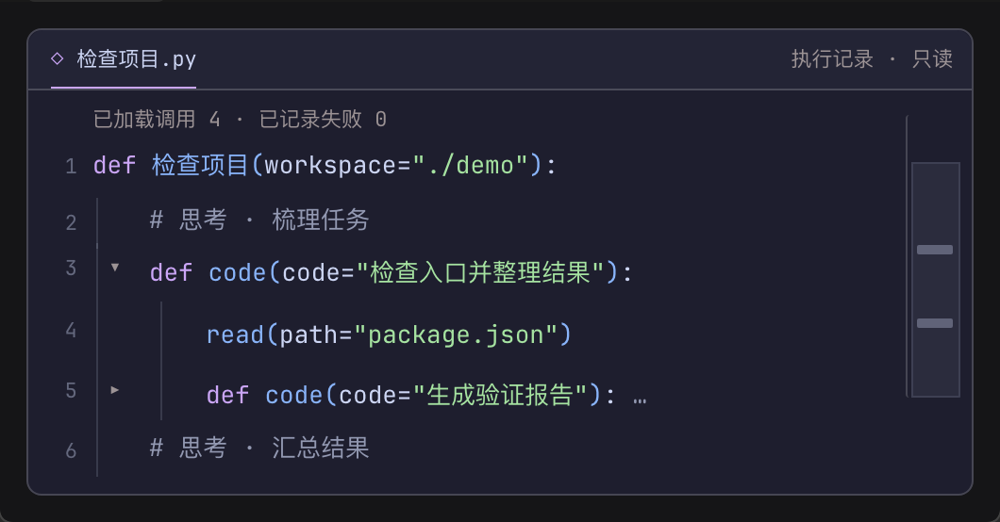 | 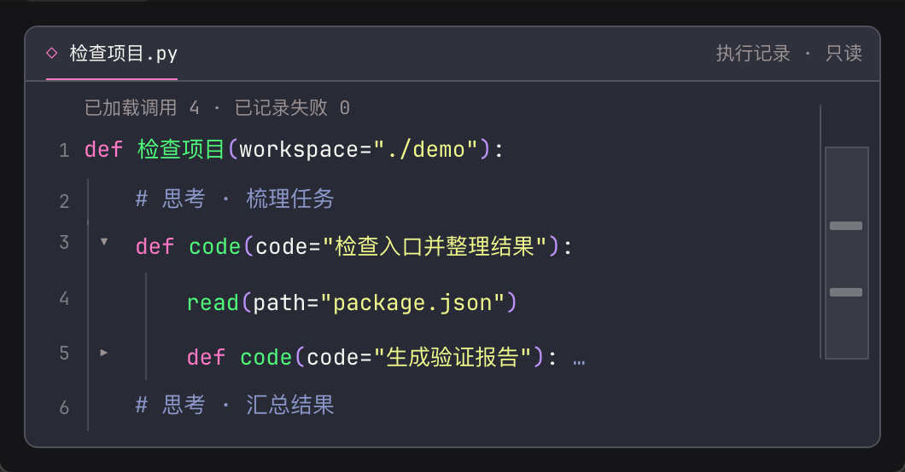 |

配色针对本插件的语法角色做了适配，部分颜色为可读性微调，并非对原 IDE 的完整复刻。来源见 [第三方声明](THIRD_PARTY_NOTICES.md)。

### 树形风格

同一组工具调用可以使用三种树形风格。图片来自隔离宿主的合成会话，点击可查看原尺寸：

| 经典曲线 | 植物手稿 | 安静线条 |
|:---:|:---:|:---:|
| [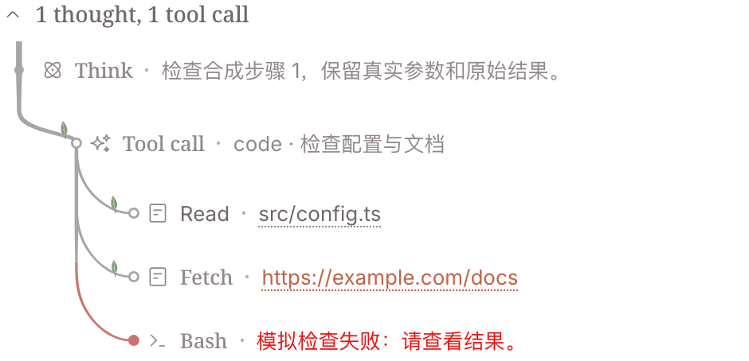](docs/images/tree-classic.png) | [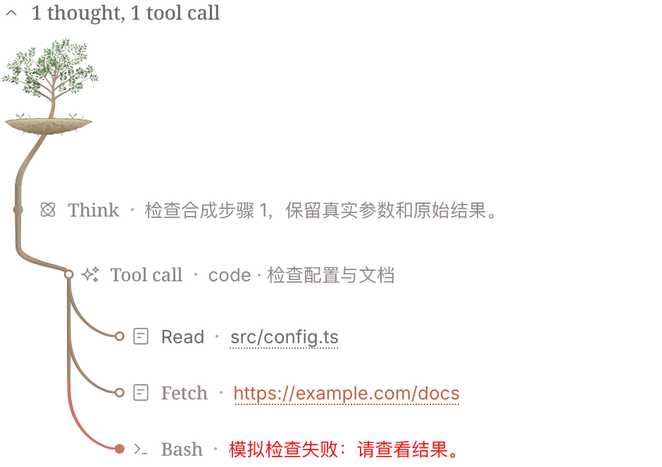](docs/images/tree-botanical.png) | [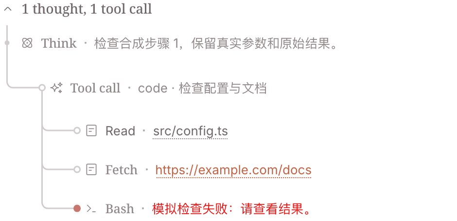](docs/images/tree-quiet.png) |

## 功能

- **任务函数与嵌套作用域**：按已记录的调用关系显示工具名称、参数、注释和子调用；独立箭头折叠子调用，不改变原生工具结果的折叠状态。
- **多语言展示**：支持 Python、JavaScript、C、C++、Java 和 Go；也可选择独立的“行尾大括号”形态。
- **状态与定位**：区分失败、已中断、结果未知和未结束；失败列表与迷你地图用于定位当前已加载、可见的调用。耗时仅在起止时间均有记录时显示。
- **保留原生交互**：文件按钮和 `web_fetch` 网页链接在能够安全匹配时沿用宿主原有操作；原生结果仍可展开，长参数可查看完整记录。无法安全匹配或缺少结构化记录时保留原生摘要，不猜测参数。
- **长记录**：优先处理视口附近的调用，其余记录分批转换；未转换的行继续显示原生摘要。远离视口的历史过程释放绘制资源，滚回时恢复。

这些语言视图是**只读的执行记录示意**，不是原始源代码或可执行程序；子调用的展示顺序不证明其串行执行，也不推断真实函数签名。Java 和 Go 对对象、数组、不完整参数或不适合的工具名保留原生摘要；其位置参数可通过展开查看原始参数名。Python、JavaScript、C 和 C++ 在无法无损表示数字或重复参数名时使用省略号，并保留原始参数详情。

“结果未知”仅用于宿主明确标记未知，或结果记录缺少有效成功／失败字段的情况；不能据此推断操作是否执行。宿主标记失败而结构化结果记录为成功时，会单独计数，不推断命令退出码。

## 安装

### 通过插件市场

1. 打开 **插件 → 实验性插件**，启用 **自定义插件市场 / Custom plugin markets**（部分版本显示为 Custom plugin indexes）。
2. 进入 **发现 / Discover → 添加索引源 / Add index source**。已有索引时，可在市场菜单选择 **管理索引源…**。
3. 添加以下地址，选择 **Bosaiting 过程树**，搜索 `dsh-process-tree`，确认来源为 `https://registry.npmjs.org` 后安装。

```text
https://raw.githubusercontent.com/Bosaiting/dsh-process-tree/main/market/index.json
```

按提示重启。索引源按 profile 保存，其他用户需要各自添加；排查方法见 [Discover 安装说明](docs/DISCOVER.md)。

### 命令行或离线安装

```sh
# 安装最新版到 Web profile
dsh plugin --profile web add dsh-process-tree@latest

# 或安装固定版本
dsh plugin --profile web add dsh-process-tree@0.11.0
```

离线安装可先下载 npm 包，再使用实际文件名：

```sh
npm pack dsh-process-tree@0.11.0
dsh plugin --profile web add ./dsh-process-tree-0.11.0.tgz
```

安装后重启对应 DSH 实例。桌面版使用插件管理界面；已验证的 macOS 桌面版也可使用其自带 CLI 管理 `desktop` profile。不要直接修改桌面应用安装目录。

## 设置

打开 **设置 → 插件 → 过程树**。首次安装和恢复默认时使用以下组合：

| 项目 | 默认值 |
| --- | --- |
| 风格 | 代码块 |
| 代码形态 | 任务函数 |
| 展示语言 | Python |
| 浅色配色 | VS Code Light+ |
| 深色配色 | JetBrains Darcula |
| 代码背景 | 使用配色方案背景 |

已保存的有效风格和颜色选择不会因默认值变化而被覆盖。代码模式隐藏树形风格使用的**强度**、**状态颜色**和**高级设置**；切回树形风格后可继续调整相关选项。

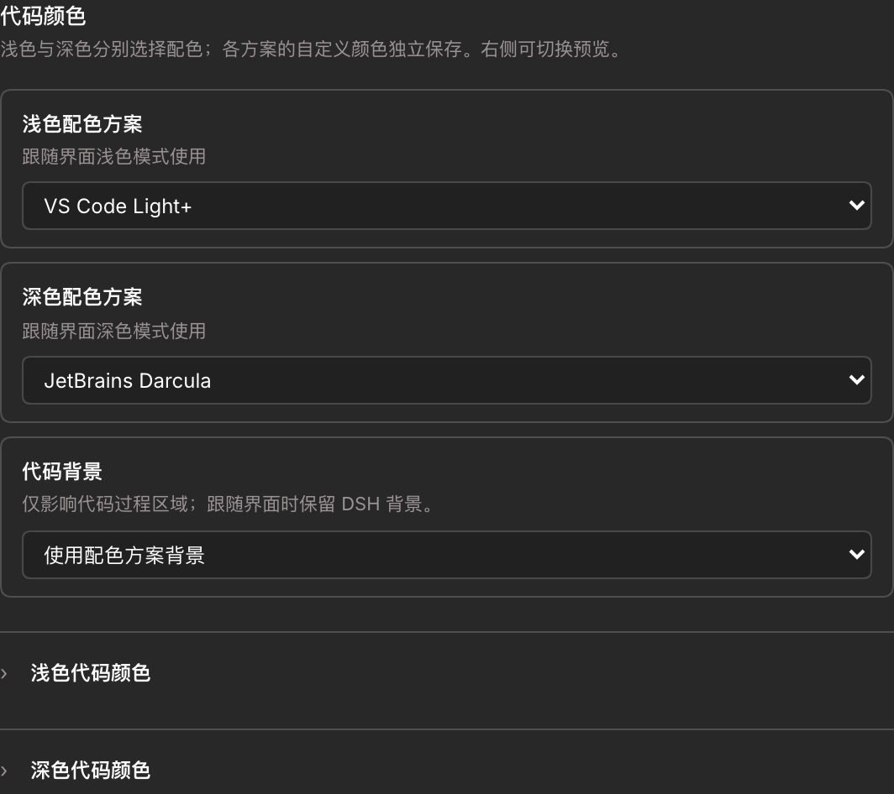

浅色方案包括 VS Code Light+、JetBrains Light、Catppuccin Latte 和 Alucard Light；深色方案包括 VS Code Dark+、JetBrains Darcula、Catppuccin Mocha 和 Dracula Classic。每种方案各自保存自定义颜色，方案内的恢复按钮只重置当前方案；**恢复默认**会重置整个插件设置。切换配色无需联网。

代码颜色可分别调整函数与工具、关键字、参数名、字符串与文件、数字、注释、普通文字和三级括号颜色。若退回旧版并由旧版保存设置，当前生效的颜色会保留，但方案选择和其他方案的自定义值可能丢失，建议先备份设置。

三种树形风格可分别设置浅色和深色的运行、错误颜色。线条、圆点、缩进、摘要浓度与行距等细项位于折叠的**高级设置**中。植物手稿提供默认关闭的植物滚动优化；开启后，其他直接访问根系内部元素的插件或自定义 CSS 可能受到影响。

## 兼容性与数据

0.11.0 不按 DSH 版本号阻止安装或加载；这不等于未来版本都已测试。rc.5 已通过隔离 Web 宿主检查；原生桌面的持续运行、Windows 和 Linux 等仍有未验证范围。旧版 0.8.2 的 RC2／RC5 限制保持其原始发布记录。具体证据见 [兼容性记录](docs/COMPATIBILITY.md)。

插件读取已显示的聊天结构、元素尺寸和当前会话已加载的 Chat 投影，不额外加载历史；不注册模型工具、不执行命令、不发送网络请求。设置保存在当前界面的 `localStorage`（`dsh.process-tree.v1`）；卸载不会清除偏好。若存储不可用，设置页会提示，恢复后再次调整可重试。

Claude Style 不是运行依赖。建议停用重复添加缩进或过程连接线的插件，避免相同区域被重复修改。

## 文档

| 文档 | 内容 |
| --- | --- |
| [插件市场](docs/DISCOVER.md) | 添加索引源、安装与排查 |
| [兼容性记录](docs/COMPATIBILITY.md) | 已验证环境、测试证据与未验证范围 |
| [更新日志](CHANGELOG.md) | 版本变更 |
| [第三方声明](THIRD_PARTY_NOTICES.md) | 配色来源、版权与许可 |

## 卸载

```sh
dsh plugin --profile web remove dsh-process-tree
```

重启对应实例；桌面版可使用插件管理界面。无需删除整个 DSH profile。

## 开发与验证

需要 Node.js 22.19 或更新版本。运行文件已入库，无须构建；React 和 Playwright 开发依赖仅供测试。

```sh
npm ci
npm test
npx playwright install chromium
npm run test:browser
npm run check:package
```

已有 Chromium 可通过 `DSH_CHROMIUM_EXECUTABLE` 指定。宿主检查、测试范围和限制见 [兼容性记录](docs/COMPATIBILITY.md)。提交问题时请提供 DSH 版本、系统、所选风格及其他界面插件，避免附带私人聊天内容。

## 许可与致谢

MIT，见 [LICENSE](LICENSE)。树冠 SVG 为项目所有者原创。缩进、摘要浓度和行距部分改编自 Asheep233 的 [dsh-tool-indent](https://github.com/Asheep233/dsh-tool-indent)，原版权及许可保留在 [THIRD_PARTY_NOTICES.md](THIRD_PARTY_NOTICES.md)。
