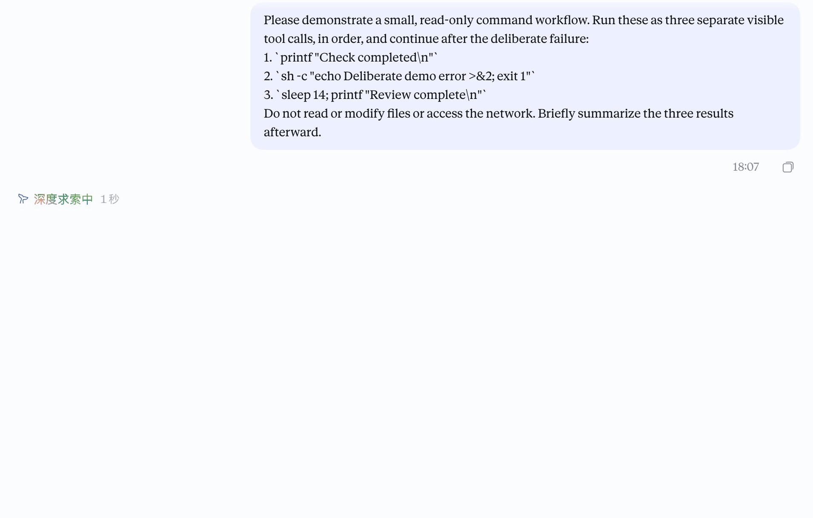

# dsh-process-tree

[English](README.en.md)

给 DeepSeek Harness 的任务过程添加树形连接线。默认使用经典曲线，另有安静线条和植物树冠风格。支持嵌套工具调用、状态圆点、按视口绘制和减少动态效果设置。

这是社区界面插件，适用于 DSH Web 和使用同一界面的桌面版。TUI 不显示此插件。已验证环境和限制见 [兼容性记录](docs/COMPATIBILITY.md)。

## 效果预览

### 跟着任务生长

一段真实的 DSH 桌面对话：任务依次运行三个只读命令，分支随调用出现；第二步是有意设置的失败。



### 浅色与深色

同一段对话在两种界面外观下的效果：


### 安装前后

左侧为未安装插件的原始过程，右侧为安装过程树后的相同记录。


### 同时看见不同状态

灰色节点已完成，红色节点是演示中的预期失败，蓝色节点正在运行。


动图和状态图录自专门创建的桌面演示会话；两组对比图使用该会话的脱敏记录，在隔离的 DSH Web 实例中回放。图片展示采集时的开发版；状态颜色可以自定义，外观也可能与已发布版本有所不同。

## 安装

当前明确支持 **DSH 0.2.1-rc.2**；其他版本尚未验证。

### 通过 Discover 安装

1. 打开 **插件 → 实验性插件**，启用 **自定义插件市场 / Custom plugin markets**（部分版本显示为 Custom plugin indexes）。
2. 进入 **发现 / Discover**，选择 **添加索引源 / Add index source**；已有索引时，从市场菜单进入 **管理索引源…**。
3. 粘贴下面的完整地址，添加后选择 **Bosaiting 过程树**。

```text
https://raw.githubusercontent.com/Bosaiting/dsh-process-tree/main/market/index.json
```

搜索 `dsh-process-tree` 或“过程树”，核对安装目标为 **`dsh-process-tree@0.7.4`**、来源为 **`https://registry.npmjs.org`**，确认安装并按提示重启。已安装时可直接打开现有插件。索引源按 profile 保存，其他用户需要各自添加。

这是项目维护者提供的独立社区索引。详细操作、加载排查和版本维护见 [Discover 安装说明](docs/DISCOVER.md)。

### 命令行或离线安装

从 [npm](https://www.npmjs.com/package/dsh-process-tree) 安装固定版本：

```sh
dsh plugin --profile web add dsh-process-tree@0.7.4
```

也可以从 GitHub 安装固定版本：

```sh
dsh plugin --profile web add "github:Bosaiting/dsh-process-tree#v0.7.4"
```

也可以从 [v0.7.4 Release](https://github.com/Bosaiting/dsh-process-tree/releases/tag/v0.7.4) 下载 `dsh-process-tree-0.7.4.tgz`，然后本地安装：

```sh
dsh plugin --profile web add ./dsh-process-tree-0.7.4.tgz
```

安装后重新启动对应的 DSH 实例。桌面版通过其插件管理入口安装到桌面配置；已验证的 macOS 版本也可由桌面程序自带的 CLI 管理 `desktop` profile，单独安装的 CLI 行为可能不同。不要直接修改桌面安装目录。该插件不需要安装时构建或构建脚本许可。

使用原版 DSH 即可；Claude Style 不属于运行依赖。建议停用重复提供缩进或过程连接线的插件，尤其是 `dsh-tool-indent` 和其他过程树/时间线装饰，以免同时修改相同的间距和 CSS 变量。

## 设置

打开 **设置 → 插件 → 过程树**。主设置提供风格、强度、动画和状态颜色：浅色与深色界面的运行、错误颜色可以分别选择或输入六位 HEX 值，修改后立即生效并自动保存。也可单独恢复状态颜色，不影响其他偏好。

经典曲线的轻、标准、鲜明三档线宽分别为 3.10、3.80、4.64 px；植物手稿分别为 3.20、4.60、6.28 px。已保存的线宽保持不变；重新选择强度后应用新的预设值。

| 风格 | 外观 |
| --- | --- |
| 经典曲线 `classic`，默认 | 流动曲线、粗细衰减，完成的工具步骤长出叶片 |
| 植物手稿 `botanical` | 原创小树冠、带明暗的木质根系和状态光晕 |
| 安静线条 `quiet`，低调模式 | 1.5 px 等宽线，直主干，圆角分支，各层级一致的圆点 |

其余细项（分支过渡、线宽、纹理、叶片、圆点、缩进、摘要浓度、行距、生长速度等）收在默认折叠的 **高级设置** 中；在高级设置里改动线宽或圆点后，强度显示为自定义，重新选择一档即可恢复。植物风格下另有树冠设置。设置预览与聊天区使用同一渲染器，可切换预览状态和浅色、深色主题。安静线条以节点显示状态色；植物手稿的运行分支保持木色，节点及微光使用运行色。

减少动态效果会停止生长和状态微动效。远离视口的历史过程释放绘制资源并保留布局占位；滚回时重新创建。首次安装及缺少有效风格字段的早期设置使用经典曲线，保留行外观和树冠偏好；已保存的有效风格选择不变。

## 数据与权限

插件读取已显示的聊天结构和元素尺寸，追加装饰 SVG；不注册模型工具、不执行命令、不发送网络请求。偏好仅保存在当前界面的 `localStorage`，键为 `dsh.process-tree.v1`。它不修改会话内容，也不读取 API 密钥。卸载保留偏好；可在设置中恢复默认值。

## 卸载

```sh
dsh plugin --profile web remove dsh-process-tree
```

重新启动相应实例；桌面版使用插件管理界面。不要删除整个 DSH profile。

## 开发与验证

需要 Node.js 22.19 或更新版本。运行文件已入库，无须构建。开发依赖只有测试工具及测试使用的 React，不会打入插件。

```sh
npm ci
npm test
npx playwright install chromium
npm run test:browser
npm run check:package
npm pack
```

已有 Chromium 可通过 `DSH_CHROMIUM_EXECUTABLE` 指定；浏览器测试默认使用锁定的 React 依赖，完整执行设置预览检查。与其他插件共存的额外检查可通过 `DSH_COMPOSER_SOURCE` 和 `DSH_CLAUDE_ROW_SKIP_CSS` 指定独立取得的源码，不是基础测试的前提。

旧的三风格静态示意图可在安装浏览器后运行 `node scripts/capture-previews.mjs` 重新生成，同样支持 `DSH_CHROMIUM_EXECUTABLE`。上方的实录与回放截图需要通过 DSH 界面重新采集。

`canopy.svg` 保留原始树冠图稿；运行时使用 `client.js` 中经过参数化的内嵌图稿，修改原图不会自动更新运行文件。原图不重复放入安装包。

真实宿主测试的运行方式与证据范围见 [兼容性记录](docs/COMPATIBILITY.md)。不要把 DOM 夹具中的测试结果写成桌面帧率结论。提交问题时请提供 DSH 版本、系统、风格、其他界面插件及复现步骤，避免附带私人聊天内容。

## 许可与致谢

MIT，见 [LICENSE](LICENSE)。树冠 SVG 为项目所有者原创。缩进、摘要浓度和行距部分改编自 Asheep233 的 [dsh-tool-indent](https://github.com/Asheep233/dsh-tool-indent)，原版权及许可完整保留在 [THIRD_PARTY_NOTICES.md](THIRD_PARTY_NOTICES.md)。
